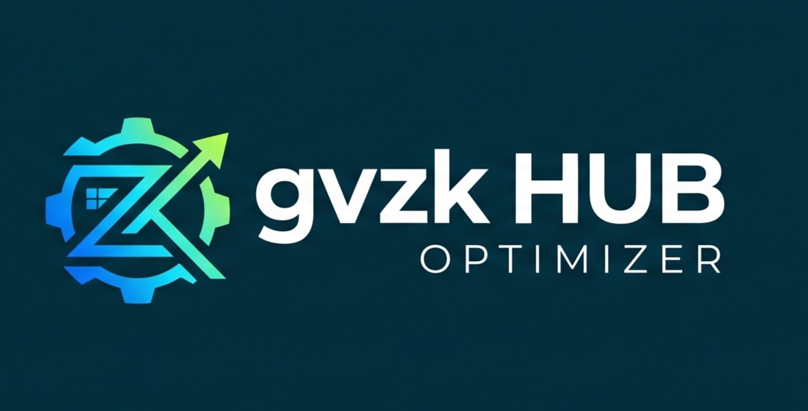

<p align="center">
  
</p>

<h1 align="center">gvzk HUB Optimizer</h1>

<p align="center">
  <b>Uma suíte moderna, modular e segura de otimização, monitoramento e ajuste fino para Windows 10 e 11.</b><br>
  Reconstruído do zero com <b>.NET 8.0</b>, <b>WPF</b> e <b>Fluent Design nativo (Mica/Acrylic)</b>.
</p>

<p align="center">
  
  
  
  
  
</p>

---

## 📸 Visão Geral da Interface

```
+----------------------------------------------------------------------------------------------------+
| 🛡️ gvzk HUB Optimizer                                                                  v1.2.0 [-][x] |
+---------------------+------------------------------------------------------------------------------+
| [ LOGO HEADER ]     | 🖥️ Visão Geral do Hardware                                                  |
|                     |                                                                              |
| 🖥️ Hardware         | +-----------------------------+ +------------------------------------------+ |
| ⚡ Otimizações       | | 💻 Processador (CPU)        | | 🎮 Placa de Vídeo (GPU)                  | |
| 🧹 Limpeza          | | AMD Ryzen 7 5700X3D         | | NVIDIA GeForce RTX 3070                  | |
| 📦 Bloatwares (UWP) | | 8 Cores / 16 Threads        | | 8.0 GB VRAM Dedicada                     | |
| 🌐 Rede & Conexão   | | Base: 3.00 GHz | Boost 4.10 | | Driver 32.0.16.1074                      | |
|                     | +-----------------------------+ +------------------------------------------+ |
|                     | +-----------------------------+ +------------------------------------------+ |
|                     | | 🧠 Memória RAM              | | 💾 Unidades de Disco                     | |
|                     | | 32 GB DDR4 (2 pentes)       | | C: [NVMe/SSD] 1024 GB (820 GB livres)    | |
|                     | | Frequência: 3600 MHz        | |                                          | |
|                     | | Perfil XMP/DOCP Ativo       | |                                          | |
|                     | +-----------------------------+ +------------------------------------------+ |
|                     |                                                                              |
|                     | [ 🔍 Mostrar Mais Especificações Avançadas (Áudio, Periféricos, BIOS) ]      |
+---------------------+------------------------------------------------------------------------------+
```

---

## 🌟 Módulos e Funcionalidades

### 1. 🖥️ Dashboard de Hardware (Início)
* **Processador em Tempo Real:** Identificação da CPU, quantidade de núcleos/threads, **Frequência Base** e **Frequência Turbo (Boost)** calculada por arquitetura.
* **Placa de Vídeo (GPU):** Leitura de 64-bit do registro (`HardwareInformation.qwMemorySize`), ultrapassando a limitação histórica de 4 GB do WMI para reportar com exatidão **8.0 GB+ de VRAM Dedicada** e versão do driver.
* **Memória RAM:** Capacidade total, quantidade de módulos físicos instalados, frequência real configurada em MHz/MT/s (ex.: **3600 MHz**) e perfil XMP/DOCP.
* **Armazenamento:** Discos instalados, espaço livre e saúde/tipo (SSD/NVMe).
* **Especificações Avançadas:** Painel expansível com Placa-Mãe, versão/data da BIOS, dispositivos de Áudio e periféricos USB (teclados, mouses e controladores).

---

### 2. ⚡ Otimizações e Ajustes do Windows (Tweaks Reversíveis)
Segurança em primeiro lugar: todas as alterações contam com rotinas de reversão e verificação em tempo real.

#### 🛡️ Barra de Ações Rápidas em Destaque:
* **`🛡️ Criar Ponto de Restauração`:** Gera um ponto de restauração do sistema antes de aplicar alterações.
* **`⚡ Plano Desempenho Máximo`:** Ativa o plano de alto rendimento oculto do Windows (*Ultimate Performance*), eliminando micro-travamentos e latências de transição de clock da CPU.
* **`🚫 Retirar Transparência`:** Desativa os efeitos acrílicos de blur do Windows, economizando processamento de GPU e memória de vídeo.
* **`🚀 Visual Desempenho (Fontes/Miniaturas)`:** Aplica o perfil ideal de efeitos visuais:
  * Desativa animações de janela, sombras e transições lentas.
  * **Preserva explicitamente:** Fontes de tela com cantos arredondados (ClearType) e exibição de miniaturas de arquivos no Explorer.
* **`📋 Restaurar Win + V`:** Desbloqueia as políticas restritivas do `HKLM` e reativa o Histórico da Área de Transferência.
* **`🔄 Reiniciar Explorer`:** Recarrega o `explorer.exe` com um clique para aplicar ajustes visuais instantaneamente.

#### 💡 Badges Visuais Informativos:
Cada ajuste possui uma etiqueta com a sua necessidade de reinício:
* 🟢 **`⚡ Imediato`** — entra em vigor na mesma hora.
* 🟠 **`🔄 Requer Reiniciar Explorer`** — entra em vigor ao clicar em *Reiniciar Explorer*.
* 🟣 **`💻 Requer Reiniciar PC`** — ajustes profundos de kernel e serviços que exigem reinício completo do Windows.

---

### 3. 🧹 Limpeza do Sistema (Cleaner)
* **Analisador em Tempo Real:** Ao abrir a aba, calcula assincronamente a quantidade exata de lixo em disco em cada diretório.
* **Categorias Limpas:** Arquivos temporários do usuário (`%TEMP%`), temporários do Windows (`Windows\Temp`), Prefetch, cache do Windows Update (`SoftwareDistribution\Download`), relatórios de falhas (WER) e esvaziamento seguro da Lixeira via Shell32 API.
* Exibição de MB/GB recuperados na sessão.

---

### 4. 📦 Desinstalador UWP (Bloatwares)
* Varredura dinâmica de aplicativos pré-instalados da Microsoft e parceiros OEM (Clipchamp, Bing Search, Bing Weather, Microsoft 365, Novo Outlook, Power Automate, Dev Home, Gravador de Som, Alarmes, Xbox Overlays, Spotify, myHP, etc.).
* Seleção múltipla e desinstalação segura em lote via PowerShell AppX APIs.

---

### 5. 🌐 Rede & Velocidade
* **Speedtest Multi-Stream:**
  * Medição de latência (**Ping**) em milissegundos.
  * Teste de velocidade de **Download Real (Mbps)** utilizando streams paralelos de alta capacidade.
  * Teste de velocidade de **Upload Real (Mbps)** com medição de taxa de transferência de envio.
* **Otimizador de DNS:** Troca rápida com 1 clique para Cloudflare (1.1.1.1), Google (8.8.8.8), Quad9, AdGuard ou restauração para automático (DHCP).
* **Flush DNS:** Limpeza instantânea do cache de resolução de nomes do sistema.

---

## 🛠️ Tecnologias e Arquitetura

* **Linguagem:** C# (.NET 8.0 Windows Desktop SDK)
* **Interface Gráfica:** WPF com Fluent Design (Lepo.WPF-UI 4.3) e efeito Mica nativo do Windows 11
* **Acesso ao Sistema:**
  * `System.Management` (WMI / CIM para CPU, RAM, GPU e Dispositivos)
  * `Microsoft.Win32.Registry` (Manipulação segura de chaves HKCU e HKLM)
  * `Win32 P/Invoke` (`SystemParametersInfo`, `SHEmptyRecycleBin`, `SHQueryRecycleBin`)
  * `PowerShell SDK / CLI` (AppX Packages, Power Schemes, Restore Points)
* **Privilégios:** Manifesto com `requireAdministrator` para garantir execução com permissões totais no Windows.

---

## 🚀 Como Compilar e Rodar

### Pré-requisitos
* [.NET 8.0 SDK](https://dotnet.microsoft.com/download/dotnet/8.0)
* Windows 10 (1809+) ou Windows 11

### Compilação do Executável Portátil (Single-File Standalone):
```bash
git clone https://github.com/kevensousa/gvzk-hub-optimizer.git
cd gvzk-hub-optimizer
dotnet publish -c Release -r win-x64 --self-contained true -p:PublishSingleFile=true -p:IncludeNativeLibrariesForSelfExtract=true -o ./publish
```
O executável gerado em `./publish/GvzkHubOptimizer.exe` é **100% autônomo** e roda direto sem necessidade de instalar runtimes adicionais!

---

## 📄 Licença
Distribuído sob a licença MIT. Veja `LICENSE` para mais informações.
